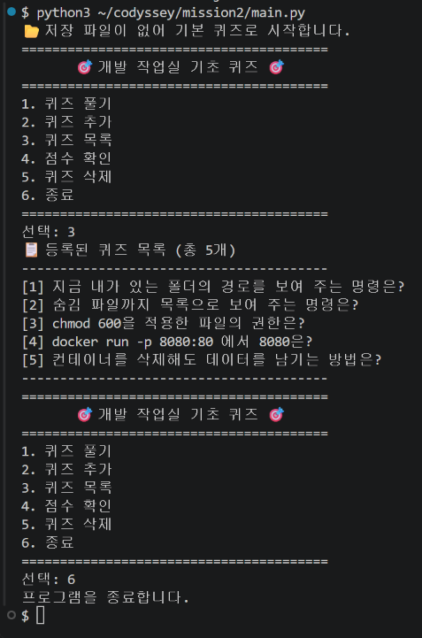
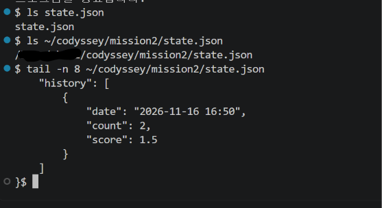

# 나만의 퀴즈 게임 (mission2)

> 터미널에서 동작하는 4지선다 퀴즈 게임입니다. 1주차에 직접 실습한 개발 작업실 기초(터미널, 권한, Docker)를 문제로 만들었습니다.

- GitHub 저장소: https://github.com/jjin1990/mission2

## 목차

1. [프로젝트 개요](#1-프로젝트-개요)
2. [퀴즈 주제와 선정 이유](#2-퀴즈-주제와-선정-이유)
3. [실행 환경](#3-실행-환경)
4. [실행 방법](#4-실행-방법)
5. [기능 목록](#5-기능-목록)
6. [실행 화면](#6-실행-화면)
7. [파일 구조와 클래스 설계](#7-파일-구조와-클래스-설계)
8. [데이터 파일 설명 (state.json)](#8-데이터-파일-설명-statejson)
9. [예외 처리 설계](#9-예외-처리-설계)
10. [Git 작업 기록](#10-git-작업-기록)
11. [수행 체크리스트](#11-수행-체크리스트)
12. [개발 과정](#12-개발-과정)
13. [트러블슈팅](#13-트러블슈팅)
14. [검증 방법](#14-검증-방법)
15. [배운 점과 알려진 한계](#15-배운-점과-알려진-한계)
16. [제출 정보](#16-제출-정보)

## 1. 프로젝트 개요

Python으로 만든 터미널 퀴즈 게임입니다. 메뉴에서 번호를 골라 퀴즈를 풀고, 추가하고, 목록과 점수를 확인하고, 삭제할 수 있습니다. 퀴즈와 최고 점수, 게임 기록은 `state.json`에 저장되어 프로그램을 껐다 켜도 남아 있습니다.

기본 기능을 완성한 뒤 코드를 역할별로 파일 4개로 나누었고, 보너스 과제 5개(랜덤 출제, 문제 수 선택, 힌트, 퀴즈 삭제, 점수 기록 히스토리)를 모두 구현했습니다. 직접 써 보면서 발견한 버그 2개(0점인데 최고 점수로 기록됨, 퀴즈 도중 Ctrl+C를 누르면 오류로 꺼짐)도 고쳤습니다.

| 항목 | 내용 |
| --- | --- |
| 실행 | `python3 main.py` |
| Python | 3.14.4 (미션 요구: 3.10 이상) |
| 외부 라이브러리 | 없음 (표준 라이브러리 `json`, `random`, `datetime`만 사용) |
| 클래스 | `Quiz`(문제 한 장), `QuizGame`(게임 전체 관리) |
| 파일 | `main.py`, `quiz.py`, `quiz_data.py`, `quiz_game.py` |
| 데이터 파일 | `state.json` (UTF-8) |
| 메뉴 | 퀴즈 풀기 / 퀴즈 추가 / 퀴즈 목록 / 점수 확인 / 퀴즈 삭제 / 종료 |

## 2. 퀴즈 주제와 선정 이유

- **주제:** 1주차 입학연수 미션 1에서 실습한 개발 작업실 기초 (터미널 명령, 파일 권한, Docker)
- **선정 이유:** 미션 1을 다시 공부하면서 그때 배운 명령과 개념을 익히고 익숙해지기 위해 골랐습니다.

| 번호 | 문제 | 정답 | 미션 1에서 실습한 내용 |
| --- | --- | --- | --- |
| 1 | 지금 내가 있는 폴더의 경로를 보여 주는 명령은? | `pwd` | 터미널 기본 명령 |
| 2 | 숨김 파일까지 목록으로 보여 주는 명령은? | `ls -a` | 터미널 기본 명령 |
| 3 | chmod 600을 적용한 파일의 권한은? | 주인만 읽고 쓰기 | 파일 권한 |
| 4 | docker run -p 8080:80 에서 8080은? | 내 컴퓨터(호스트) 포트 | Docker 포트 연결 |
| 5 | 컨테이너를 삭제해도 데이터를 남기는 방법은? | 볼륨 연결 | Docker 볼륨 |

기본 퀴즈 5개는 `quiz_data.py`에 있고, 문제마다 힌트도 하나씩 들어 있습니다. 퀴즈는 게임 안에서 직접 추가할 수도 있습니다.

## 3. 실행 환경

| 항목 | 내용 |
| --- | --- |
| 운영체제 | Windows + WSL (Ubuntu) |
| 편집기 | VS Code 1.146.0 (WSL 연결) |
| Python | 3.14.4 (미션 요구: 3.10 이상) |
| Git | 2.53.0 (사용자 이름: jjin1990) |
| 외부 라이브러리 | 없음 |


*VS Code를 WSL(Ubuntu)에 연결한 화면. 터미널에서 Python, Git, VS Code 버전과 Git 사용자 이름을 확인했고, 아래 상태 표시줄에 WSL: Ubuntu와 Python 3.14.4가 보입니다.*

## 4. 실행 방법

### 처음 받아서 실행하기

```bash
git clone https://github.com/jjin1990/mission2.git   # 저장소 복제
cd mission2                                          # 저장소 폴더로 이동
python3 main.py                                      # 게임 실행
```

처음 실행하면 저장 파일이 없어서 `📂 저장 파일이 없어 기본 퀴즈로 시작합니다.`가 나오고, 기본 퀴즈 5개로 시작합니다. 메뉴에서 번호(1~6)를 입력해 기능을 고르고, `6`을 누르거나 `Ctrl+C`를 누르면 저장한 뒤 종료합니다.

### 꼭 저장소 폴더 안에서 실행하기

`state.json`은 **실행한 위치(터미널이 있는 폴더)** 를 기준으로 찾고 저장합니다. 이걸 직접 확인해 보았습니다.

1. 홈 폴더(`~`)로 이동해 `ls state.json` → 파일 없음
2. 홈 폴더에서 `python3 ~/codyssey/mission2/main.py` 실행 → mission2 안에 퀴즈 6개짜리 `state.json`이 있는데도 **"저장 파일이 없어 기본 퀴즈로 시작합니다"** 가 나오고 목록은 5개
3. 종료 후 확인 → **홈 폴더에 `state.json`이 새로 생김**, mission2의 원래 파일은 바뀌지 않음
4. 실험으로 생긴 홈 폴더의 `state.json`은 `rm ~/state.json`으로 지움

그래서 저장된 퀴즈와 기록을 이어서 쓰려면 반드시 **`cd mission2`로 저장소 폴더에 들어간 뒤** 실행해야 합니다.



*홈 폴더에서 실행하자 mission2의 저장 파일을 찾지 못하고 기본 퀴즈 5개로 시작한 화면.*



*종료 후 홈 폴더에 state.json이 새로 생겼고, mission2의 원래 파일은 그대로인 것을 확인한 화면.*

## 5. 기능 목록

### 메뉴

| 번호 | 메뉴 | 하는 일 |
| --- | --- | --- |
| 1 | 퀴즈 풀기 | 풀 문제 수를 고르면(1~퀴즈 개수) 문제를 섞어서 출제합니다. 정답 입력에서 `0`을 누르면 힌트를 볼 수 있습니다. 문제마다 정답/오답과 정답 번호를 알려 주고, 끝나면 결과를 보여 줍니다. 최고 점수보다 높으면 갱신하고, 매 판 기록을 남깁니다. |
| 2 | 퀴즈 추가 | 문제, 선택지 4개, 정답 번호(1~4), 힌트를 입력받아 퀴즈를 추가하고 저장합니다. |
| 3 | 퀴즈 목록 | 등록된 퀴즈를 번호와 함께 보여 줍니다. |
| 4 | 점수 확인 | 최고 점수와 지금까지의 게임 기록(날짜·시간, 푼 문제 수, 점수)을 보여 줍니다. |
| 5 | 퀴즈 삭제 | 목록에서 번호를 고르고 한 번 더 확인(y/n)한 뒤 삭제하고 저장합니다. |
| 6 | 종료 | 저장한 뒤 종료합니다. |

### 점수 규칙

- 정답 1문제 = **1점**, 힌트를 보고 맞히면 **0.5점**, 오답 = 0점
- **0점은 최고 점수로 기록하지 않습니다.** 0점인 판도 게임 기록에는 남습니다.

### 저장되는 때

퀴즈 풀기를 마쳤을 때, 퀴즈를 추가·삭제했을 때, 종료할 때(`6`, `Ctrl+C`, `Ctrl+D` 모두) `state.json`에 저장합니다.

### 보너스 과제 구현

| 보너스 | 구현 내용 | 확인한 곳 |
| --- | --- | --- |
| 1. 랜덤 출제 | `random.sample`로 섞은 복사본을 출제해 원래 목록 순서는 그대로 | 1번 메뉴 두 번 → 순서가 매번 다름, 3번 목록은 원래 순서 |
| 2. 문제 수 선택 | 풀기 전에 1~퀴즈 개수 중 선택 | 1번 메뉴 → 2를 고르면 2문제만 출제 |
| 3. 힌트 | `Quiz`에 `hint` 속성, `0`을 누르면 힌트, 힌트 사용 시 0.5점 | 힌트 보고 정답 → "2문제 중 1.5점" |
| 4. 퀴즈 삭제 | 번호 선택 + 확인 질문, 삭제 후 저장 | 삭제 → 재실행해도 지워진 상태 |
| 5. 점수 기록 히스토리 | 날짜·시간, 푼 문제 수, 점수를 매 판 저장 | 4번 메뉴 → 기록 목록, 재실행해도 유지 |

## 6. 실행 화면

## 7. 파일 구조와 클래스 설계

## 8. 데이터 파일 설명 (state.json)

## 9. 예외 처리 설계

## 10. Git 작업 기록

## 11. 수행 체크리스트

## 12. 개발 과정

## 13. 트러블슈팅

## 14. 검증 방법

## 15. 배운 점과 알려진 한계

## 16. 제출 정보