# 나만의 퀴즈 게임 (mission2)

> 터미널에서 동작하는 4지선다 퀴즈 게임입니다. 1주차에 직접 실습한 개발 작업실 기초(터미널, 권한, Docker)를 문제로 만들었습니다.

- GitHub 저장소: https://github.com/jjin1990/mission2

## 목차

1. [프로젝트 개요](#1-프로젝트-개요)
2. [퀴즈 주제와 선정 이유](#2-퀴즈-주제와-선정-이유)
3. [실행 환경](#3-실행-환경)
4. [실행 방법](#4-실행-방법)
5. [기능 목록](#5-기능-목록)
6. [실행 화면](#6-실행-화면)
7. [파일 구조와 클래스 설계](#7-파일-구조와-클래스-설계)
8. [데이터 파일 설명 (state.json)](#8-데이터-파일-설명-statejson)
9. [예외 처리 설계](#9-예외-처리-설계)
10. [Git 작업 기록](#10-git-작업-기록)
11. [수행 체크리스트](#11-수행-체크리스트)
12. [개발 과정](#12-개발-과정)
13. [트러블슈팅](#13-트러블슈팅)
14. [검증 방법](#14-검증-방법)
15. [배운 점과 알려진 한계](#15-배운-점과-알려진-한계)
16. [제출 정보](#16-제출-정보)

## 1. 프로젝트 개요

Python으로 만든 터미널 퀴즈 게임입니다. 메뉴에서 번호를 골라 퀴즈를 풀고, 추가하고, 목록과 점수를 확인하고, 삭제할 수 있습니다. 퀴즈와 최고 점수, 게임 기록은 `state.json`에 저장되어 프로그램을 껐다 켜도 남아 있습니다.

기본 기능을 완성한 뒤 코드를 역할별로 파일 4개로 나누었고, 보너스 과제 5개(랜덤 출제, 문제 수 선택, 힌트, 퀴즈 삭제, 점수 기록 히스토리)를 모두 구현했습니다. 직접 써 보면서 발견한 버그 2개(0점인데 최고 점수로 기록됨, 퀴즈 도중 Ctrl+C를 누르면 오류로 꺼짐)도 고쳤습니다.

| 항목 | 내용 |
| --- | --- |
| 실행 | `python3 main.py` |
| Python | 3.14.4 (미션 요구: 3.10 이상) |
| 외부 라이브러리 | 없음 (표준 라이브러리 `json`, `random`, `datetime`만 사용) |
| 클래스 | `Quiz`(문제 한 장), `QuizGame`(게임 전체 관리) |
| 파일 | `main.py`, `quiz.py`, `quiz_data.py`, `quiz_game.py` |
| 데이터 파일 | `state.json` (UTF-8) |
| 메뉴 | 퀴즈 풀기 / 퀴즈 추가 / 퀴즈 목록 / 점수 확인 / 퀴즈 삭제 / 종료 |

## 2. 퀴즈 주제와 선정 이유

- **주제:** 1주차 입학연수 미션 1에서 실습한 개발 작업실 기초 (터미널 명령, 파일 권한, Docker)
- **선정 이유:** 미션 1을 다시 공부하면서 그때 배운 명령과 개념을 익히고 익숙해지기 위해 골랐습니다.

| 번호 | 문제 | 정답 | 미션 1에서 실습한 내용 |
| --- | --- | --- | --- |
| 1 | 지금 내가 있는 폴더의 경로를 보여 주는 명령은? | `pwd` | 터미널 기본 명령 |
| 2 | 숨김 파일까지 목록으로 보여 주는 명령은? | `ls -a` | 터미널 기본 명령 |
| 3 | chmod 600을 적용한 파일의 권한은? | 주인만 읽고 쓰기 | 파일 권한 |
| 4 | docker run -p 8080:80 에서 8080은? | 내 컴퓨터(호스트) 포트 | Docker 포트 연결 |
| 5 | 컨테이너를 삭제해도 데이터를 남기는 방법은? | 볼륨 연결 | Docker 볼륨 |

기본 퀴즈 5개는 `quiz_data.py`에 있고, 문제마다 힌트도 하나씩 들어 있습니다. 퀴즈는 게임 안에서 직접 추가할 수도 있습니다.

## 3. 실행 환경

| 항목 | 내용 |
| --- | --- |
| 운영체제 | Windows + WSL (Ubuntu) |
| 편집기 | VS Code 1.146.0 (WSL 연결) |
| Python | 3.14.4 (미션 요구: 3.10 이상) |
| Git | 2.53.0 (사용자 이름: jjin1990) |
| 외부 라이브러리 | 없음 |

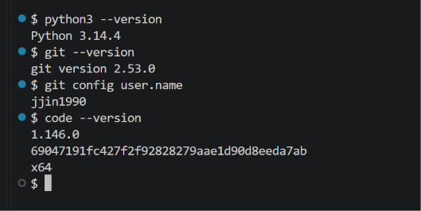

*VS Code를 WSL(Ubuntu)에 연결한 화면. 터미널에서 Python, Git, VS Code 버전과 Git 사용자 이름을 확인했고, 아래 상태 표시줄에 WSL: Ubuntu와 Python 3.14.4가 보입니다.*

## 4. 실행 방법

### 처음 받아서 실행하기

```bash
git clone https://github.com/jjin1990/mission2.git   # 저장소 복제
cd mission2                                          # 저장소 폴더로 이동
python3 main.py                                      # 게임 실행
```

처음 실행하면 저장 파일이 없어서 `📂 저장 파일이 없어 기본 퀴즈로 시작합니다.`가 나오고, 기본 퀴즈 5개로 시작합니다. 메뉴에서 번호(1~6)를 입력해 기능을 고르고, `6`을 누르거나 `Ctrl+C`를 누르면 저장한 뒤 종료합니다.

### 꼭 저장소 폴더 안에서 실행하기

`state.json`은 **실행한 위치(터미널이 있는 폴더)** 를 기준으로 찾고 저장합니다. 이걸 직접 확인해 보았습니다.

1. 홈 폴더(`~`)로 이동해 `ls state.json` → 파일 없음
2. 홈 폴더에서 `python3 ~/codyssey/mission2/main.py` 실행 → mission2 안에 퀴즈 6개짜리 `state.json`이 있는데도 **"저장 파일이 없어 기본 퀴즈로 시작합니다"** 가 나오고 목록은 5개
3. 종료 후 확인 → **홈 폴더에 `state.json`이 새로 생김**, mission2의 원래 파일은 바뀌지 않음
4. 실험으로 생긴 홈 폴더의 `state.json`은 `rm ~/state.json`으로 지움

그래서 저장된 퀴즈와 기록을 이어서 쓰려면 반드시 **`cd mission2`로 저장소 폴더에 들어간 뒤** 실행해야 합니다.


*홈 폴더에서 실행하자 mission2의 저장 파일을 찾지 못하고 기본 퀴즈 5개로 시작한 화면.*


*종료 후 홈 폴더에 state.json이 새로 생겼고, mission2의 원래 파일은 그대로인 것을 확인한 화면.*

## 5. 기능 목록

### 메뉴

| 번호 | 메뉴 | 하는 일 |
| --- | --- | --- |
| 1 | 퀴즈 풀기 | 풀 문제 수를 고르면(1~퀴즈 개수) 문제를 섞어서 출제합니다. 정답 입력에서 `0`을 누르면 힌트를 볼 수 있습니다. 문제마다 정답/오답과 정답 번호를 알려 주고, 끝나면 결과를 보여 줍니다. 최고 점수보다 높으면 갱신하고, 매 판 기록을 남깁니다. |
| 2 | 퀴즈 추가 | 문제, 선택지 4개, 정답 번호(1~4), 힌트를 입력받아 퀴즈를 추가하고 저장합니다. |
| 3 | 퀴즈 목록 | 등록된 퀴즈를 번호와 함께 보여 줍니다. |
| 4 | 점수 확인 | 최고 점수와 지금까지의 게임 기록(날짜·시간, 푼 문제 수, 점수)을 보여 줍니다. |
| 5 | 퀴즈 삭제 | 목록에서 번호를 고르고 한 번 더 확인(y/n)한 뒤 삭제하고 저장합니다. |
| 6 | 종료 | 저장한 뒤 종료합니다. |

### 점수 규칙

- 정답 1문제 = **1점**, 힌트를 보고 맞히면 **0.5점**, 오답 = 0점
- **0점은 최고 점수로 기록하지 않습니다.** 0점인 판도 게임 기록에는 남습니다.

### 저장되는 때

퀴즈 풀기를 마쳤을 때, 퀴즈를 추가·삭제했을 때, 종료할 때(`6`, `Ctrl+C`, `Ctrl+D` 모두) `state.json`에 저장합니다.

### 보너스 과제 구현

| 보너스 | 구현 내용 | 확인한 곳 |
| --- | --- | --- |
| 1. 랜덤 출제 | `random.sample`로 섞은 복사본을 출제해 원래 목록 순서는 그대로 | 1번 메뉴 두 번 → 순서가 매번 다름, 3번 목록은 원래 순서 |
| 2. 문제 수 선택 | 풀기 전에 1~퀴즈 개수 중 선택 | 1번 메뉴 → 2를 고르면 2문제만 출제 |
| 3. 힌트 | `Quiz`에 `hint` 속성, `0`을 누르면 힌트, 힌트 사용 시 0.5점 | 힌트 보고 정답 → "2문제 중 1.5점" |
| 4. 퀴즈 삭제 | 번호 선택 + 확인 질문, 삭제 후 저장 | 삭제 → 재실행해도 지워진 상태 |
| 5. 점수 기록 히스토리 | 날짜·시간, 푼 문제 수, 점수를 매 판 저장 | 4번 메뉴 → 기록 목록, 재실행해도 유지 |

## 6. 실행 화면

기본 퀴즈 5개로 시작해서 목록 → 추가 → 풀기 → 점수 → 삭제 → 종료 후 다시 실행까지 차례로 진행한 화면입니다. (시작 전에 `state.json`을 치워 두어 처음 실행하는 상황을 만들었습니다.)

### 시작과 메뉴

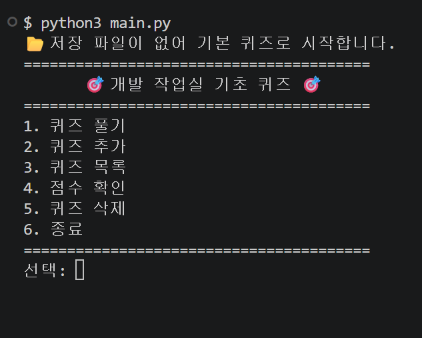

*저장 파일이 없어서 기본 퀴즈로 시작하고, 메뉴 6개가 나옵니다.*

### 퀴즈 목록

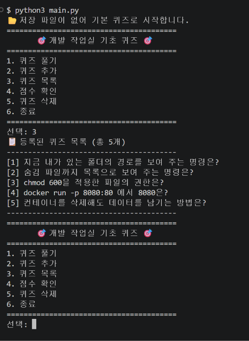

*처음에는 기본 퀴즈 5개가 있습니다.*

### 퀴즈 추가

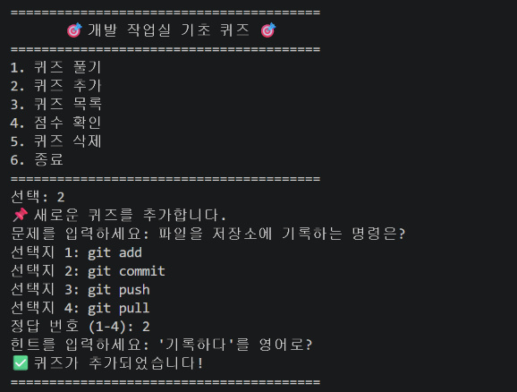

*문제, 선택지 4개, 정답 번호, 힌트를 입력해 퀴즈를 추가했습니다.*

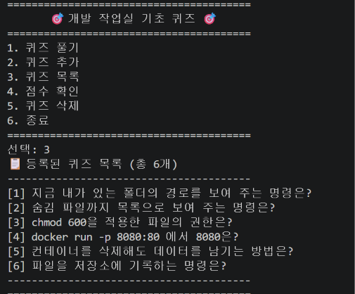

*목록이 6개가 되고, 6번에 추가한 퀴즈가 보입니다.*

### 퀴즈 풀기

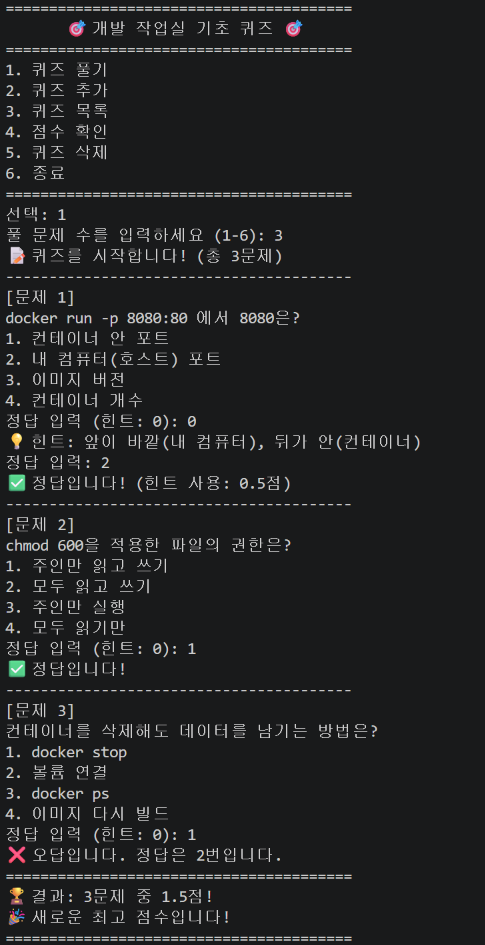

*3문제를 골랐고, 문제가 섞여서 나왔습니다. 첫 문제에서 `0`을 눌러 힌트를 본 뒤 맞혀 0.5점, 둘째 문제 정답 1점, 셋째 문제 오답으로 "3문제 중 1.5점"이 나오고 처음 기록이라 새로운 최고 점수가 되었습니다.*

### 점수 확인

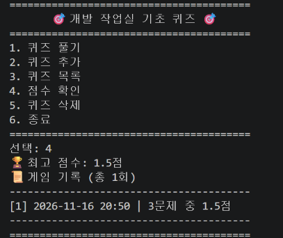

*최고 점수 1.5점과 게임 기록(날짜·시간, 푼 문제 수, 점수)이 보입니다.*

### 퀴즈 삭제

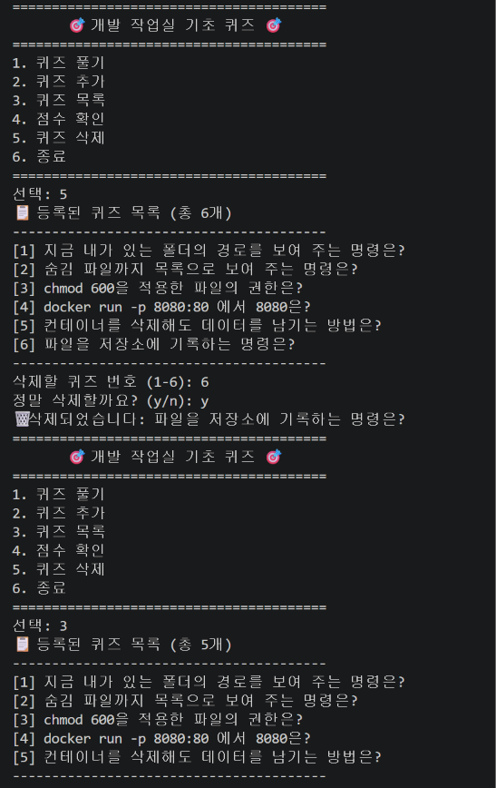

*6번 퀴즈를 골라 y로 확인하고 삭제하자 목록이 다시 5개가 되었습니다.*

### 종료 후 다시 실행

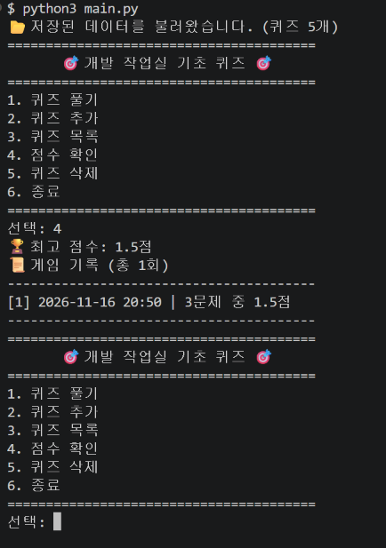

*종료 후 다시 실행하자 "저장된 데이터를 불러왔습니다. (퀴즈 5개)"가 나오고, 최고 점수와 기록도 그대로 남아 있습니다.*

## 7. 파일 구조와 클래스 설계

### 파일 구조

```
mission2/
├── main.py          # 시작점: QuizGame을 만들고 실행 (Ctrl+C·Ctrl+D 안전 종료)
├── quiz.py          # Quiz 클래스 (문제 한 장)
├── quiz_data.py     # 기본 퀴즈 5개를 만드는 함수
├── quiz_game.py     # QuizGame 클래스 + 입력 함수(get_number, get_text)
├── state.json       # 저장 파일 (실행하면 생김, Git에는 올리지 않음)
├── .gitignore       # __pycache__/, *.pyc, .vscode/, state.json 제외
├── README.md
└── evidence/        # README에 넣은 사진
```

### 파일끼리 연결 (import)

```
main.py ──▶ quiz_game.py ──▶ quiz.py
                  │
                  └────────▶ quiz_data.py ──▶ quiz.py
```

- `main.py`: `from quiz_game import QuizGame` (게임을 만들고 실행만 함)
- `quiz_game.py`: `json`, `random`, `datetime`(표준 라이브러리) + `Quiz`, `create_default_quizzes`
- `quiz_data.py`: `from quiz import Quiz` (기본 퀴즈를 Quiz로 만들기 때문)
- 파일마다 **자기가 쓰는 것만** import합니다.

### 구조를 직접 확인한 방법

파일을 하나씩 열지 않고, 터미널에서 import 줄과 클래스·함수 줄만 모아서 확인했습니다.

```bash
grep -n "^import\|^from\|^class\|def " *.py
```

- `grep`: 파일에서 원하는 글자가 있는 줄만 찾아 줌
- `-n`: 찾은 줄의 **줄 번호**도 같이 보여 줌
- `"^import\|^from\|^class\|def "`: `^`는 **줄의 맨 앞**, `\|`는 **또는**. 줄 맨 앞이 `import`·`from`·`class`이거나, `def `가 들어 있는 줄
- `*.py`: 이 폴더의 **모든 파이썬 파일**에서 찾기

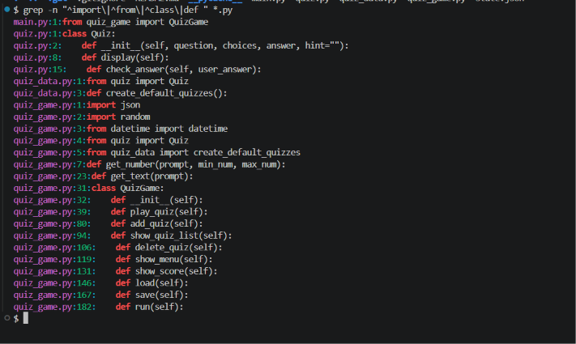

*파일마다 무엇을 import하는지, 클래스와 함수가 몇 번 줄에 있는지 한 번에 보입니다. quiz_game.py에는 함수 2개(get_number, get_text)와 QuizGame 메서드 10개가 있습니다.*

### 클래스와 함수

| 이름 | 위치 | 하는 일 |
| --- | --- | --- |
| `Quiz` | quiz.py | 문제 한 장. 속성 `question`, `choices`(4개), `answer`(1~4), `hint` |
| `Quiz.display()` | quiz.py | 문제와 선택지에 번호를 붙여 출력 |
| `Quiz.check_answer(user_answer)` | quiz.py | 정답이면 `True`, 아니면 `False`를 돌려줌 |
| `create_default_quizzes()` | quiz_data.py | 기본 퀴즈 5개(힌트 포함) 목록을 돌려줌 |
| `get_number(prompt, min_num, max_num)` | quiz_game.py | 범위 안의 숫자가 들어올 때까지 다시 묻는 입력 함수 |
| `get_text(prompt)` | quiz_game.py | 빈칸이 아닌 글자가 들어올 때까지 다시 묻는 입력 함수 |
| `QuizGame` | quiz_game.py | 게임 전체 관리. 속성 `file_path`, `quizzes`, `best_score`, `history` |

| `QuizGame` 메서드 | 하는 일 |
| --- | --- |
| `play_quiz()` | 문제 수 선택 → 섞어서 출제 → 채점(힌트 0.5점) → 기록 추가 → 점수를 돌려줌 |
| `add_quiz()` | 문제·선택지·정답·힌트를 받아 추가 |
| `show_quiz_list()` | 퀴즈 목록 출력 |
| `delete_quiz()` | 번호 선택 + 확인 후 삭제 |
| `show_menu()` | 메뉴 6개 출력 |
| `show_score()` | 최고 점수와 게임 기록 출력 |
| `load()` | `state.json`을 읽어 퀴즈·최고 점수·기록을 불러옴 |
| `save()` | 퀴즈·최고 점수·기록을 `state.json`에 저장 |
| `run()` | 메뉴를 반복해서 보여 주고, 번호에 맞는 메서드를 불러 줌 |

### 왜 이렇게 나눴나

- 처음에는 `main.py` 한 파일로 기본 기능을 완성했고, 보너스 과제를 시작하기 전에 `refactor/split-files` 브랜치에서 파일 4개로 나누었습니다. 코드가 더 커지기 전에 나눠야 옮기기 쉽다고 생각했습니다.
- **파일마다 맡은 일이 하나**라서 고칠 곳이 분명합니다. 실제로 힌트 기능은 `quiz.py`와 `quiz_data.py`, 삭제·기록 기능은 `quiz_game.py`, 도중 Ctrl+C 버그는 `main.py`만 고쳤습니다.
- 기본 퀴즈는 **데이터**라서 `quiz_data.py`로 따로 두었습니다. 문제 내용만 바꿀 때 이 파일만 열면 됩니다.
- `get_number`, `get_text`는 게임 정보(`self`)가 필요 없는 **공용 입력 도구**라서 클래스 밖에 두고, 퀴즈 풀기·추가·삭제에서 같이 씁니다.
- 나누는 동안 한 단계마다 실행해 보고 커밋해서(Refactor 커밋 3개), 어느 커밋에서도 프로그램이 동작하게 했습니다. 나눈 뒤에도 동작은 그대로인지 메뉴를 전부 다시 테스트했습니다.

## 8. 데이터 파일 설명 (state.json)

### 경로와 역할

| 항목 | 내용 |
| --- | --- |
| 경로 | 프로그램을 실행한 폴더(저장소 폴더)의 `state.json` |
| 역할 | 퀴즈 목록, 최고 점수, 게임 기록을 보관해서 프로그램을 껐다 켜도 남게 함 |
| 인코딩 | UTF-8 (`ensure_ascii=False`로 한글을 그대로 저장, `indent=4`로 사람이 읽기 좋게) |
| 만들어지는 때 | 처음 실행 후 저장할 때 (퀴즈 풀기·추가·삭제·종료) |
| Git | `.gitignore`에 넣어 저장소에 올리지 않음 |

### 스키마 (필드 구조)

```json
{
    "quizzes": [
        {
            "question": "지금 내가 있는 폴더의 경로를 보여 주는 명령은?",
            "choices": ["ls", "cd", "pwd", "mkdir"],
            "answer": 3,
            "hint": "Print Working Directory의 줄임말"
        }
    ],
    "best_score": 1.5,
    "history": [
        {"date": "2026-11-16 20:50", "count": 3, "score": 1.5}
    ]
}
```
*(퀴즈는 1개만 보이게 줄인 예시입니다. 실제 파일은 `indent=4`라서 한 줄에 값 하나씩 나옵니다.)*

| 키 | 타입 | 뜻 |
| --- | --- | --- |
| `quizzes` | 리스트 | 퀴즈 목록 |
| `quizzes[].question` | 글자 | 문제 |
| `quizzes[].choices` | 글자 4개 리스트 | 선택지 |
| `quizzes[].answer` | 숫자 1~4 | 정답 번호 |
| `quizzes[].hint` | 글자 | 힌트 (힌트 기능 전에 저장된 퀴즈는 빈 글자로 불러옴) |
| `best_score` | 숫자 또는 `null` | 최고 점수. 힌트 때문에 1.5처럼 소수가 될 수 있음. `null`은 아직 최고 점수 없음 |
| `history` | 리스트 | 게임 기록 (한 판에 하나) |
| `history[].date` | 글자 | 푼 날짜·시간 (`YYYY-MM-DD HH:MM`) |
| `history[].count` | 숫자 | 푼 문제 수 |
| `history[].score` | 숫자 | 그 판의 점수 |

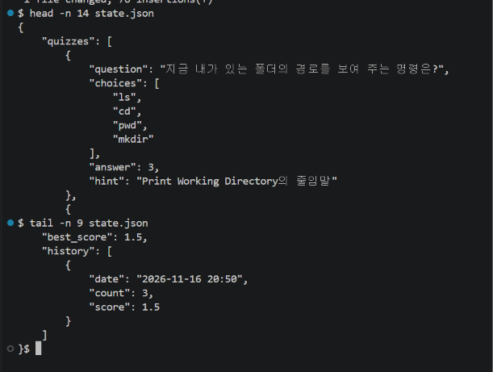

*`head`, `tail`로 확인한 실제 state.json의 앞부분(퀴즈 하나)과 끝부분(최고 점수, 기록).*

### 불러올 때 경우별 동작

| 상황 | 화면 메시지 | 결과 | 확인 |
| --- | --- | --- | --- |
| 파일이 없음 (처음 실행) | 📂 저장 파일이 없어 기본 퀴즈로 시작합니다. | 기본 퀴즈 5개, 최고 점수 없음, 기록 없음 | 테스트 (6번 실행 화면) |
| 정상 파일 | 📂 저장된 데이터를 불러왔습니다. (퀴즈 n개) | 저장된 그대로 | 테스트 (재실행) |
| JSON 문법이 깨짐 | ⚠️ 저장 파일이 손상되어 기본 퀴즈로 복구합니다. | 기본 퀴즈 5개로 복구 (`JSONDecodeError`) | 테스트 |
| `quizzes` 열쇠가 없음 | ⚠️ 저장 파일이 손상되어 기본 퀴즈로 복구합니다. | 기본 퀴즈 5개로 복구 (`KeyError`) | 테스트 |
| `quizzes`가 `null` | ⚠️ 저장 파일이 손상되어 기본 퀴즈로 복구합니다. | 기본 퀴즈 5개로 복구 (`TypeError`) | 테스트 |
| `history` 열쇠가 없는 옛 파일 | 📂 저장된 데이터를 불러왔습니다. | 퀴즈·최고 점수는 그대로, 기록은 빈 목록으로 시작 | 테스트 |
| `hint`가 없는 옛 퀴즈 | (정상 불러오기) | 힌트를 빈 글자로 불러옴 → `0`을 누르면 "이 문제는 힌트가 없습니다" | 테스트 |

손상 테스트는 진짜 파일을 `cp state.json state.json.bak`으로 복사해 두고, `echo`로 state.json을 덮어써서 만들었습니다. 끝난 뒤 백업으로 되돌렸습니다.

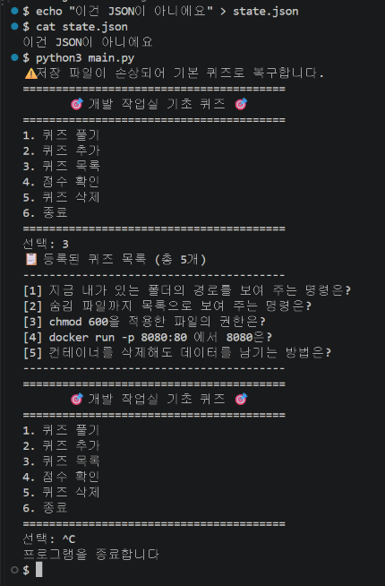

*`echo "이건 JSON이 아니에요" > state.json`으로 망가뜨린 뒤 실행 → 손상 안내 후 기본 퀴즈 5개로 시작.*

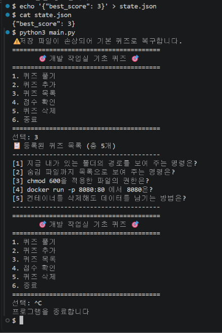

*`{"best_score": 3}`만 있는 파일 → KeyError → 같은 안내 후 기본 퀴즈로 복구.*

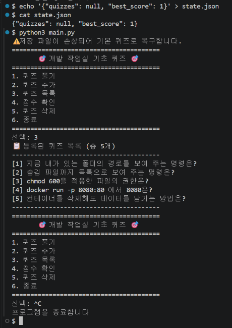

*`{"quizzes": null, "best_score": 1}` → TypeError → 같은 안내 후 기본 퀴즈로 복구.*

- 나중에 추가한 `history`와 `hint`는 `data.get("history", [])`, `item.get("hint", "")`처럼 **없으면 기본값**으로 꺼내서, 기능을 추가하기 전에 저장된 파일도 그대로 불러올 수 있게 했습니다.
- 불러오다가 중간에 오류가 나도, 예외 처리에서 퀴즈·최고 점수·기록을 **모두 처음 상태로 다시 채우기** 때문에 일부만 남는 일이 없습니다.

### state.json을 Git에 올리지 않은 이유

실행할 때마다 바뀌는 데이터라서 저장소에는 올리지 않았습니다. 파일이 없어도 기본 퀴즈 5개로 시작하기 때문에, 저장소를 받은 사람은 처음 상태에서 퀴즈 추가 → 종료 → 다시 실행으로 저장이 유지되는 것을 직접 확인할 수 있습니다.

## 9. 예외 처리 설계

잘못된 입력이나 예상하지 못한 상황에서도 프로그램이 꺼지지 않고, 안내한 뒤 다시 입력받도록 만들었습니다.

### 입력 처리

| 상황 | 처리 | 담당 | 확인 |
| --- | --- | --- | --- |
| 메뉴에 1~6이 아닌 값 (`7`, `abc`, 빈칸) | ⚠️ 잘못된 입력입니다. 1-6 사이의 숫자를 입력하세요 → 메뉴 다시 | `run` | 테스트 |
| 앞뒤 공백 (` 1 `) | `.strip()`으로 공백을 지우고 처리 | `run`, `get_number`, `get_text` | 테스트 |
| 숫자 입력이 빈칸 | ⚠️ 입력이 비어 있어요. 숫자를 입력하세요. → 다시 물음 | `get_number` | 테스트 |
| 숫자 자리에 글자 (`abc`) | ⚠️ 숫자를 입력하세요. → 다시 물음 (`ValueError` 처리) | `get_number` | 테스트 |
| 범위 밖 숫자 (정답 `9`, 문제 수 `0`·`7`) | ⚠️ (최소)-(최대) 사이의 숫자를 입력하세요. → 다시 물음 | `get_number` | 테스트 |
| 문제·선택지·힌트가 빈칸이거나 공백만 | ⚠️ 입력이 비어 있어요. 다시 입력하세요. → 다시 물음 | `get_text` | 테스트 |
| 삭제 확인에 `y`가 아닌 값 | 삭제를 취소했습니다. (지우지 않는 쪽으로) | `delete_quiz` | 테스트 |

`get_number`는 정답 번호(0~4), 풀 문제 수(1~퀴즈 개수), 삭제할 번호, 추가할 정답 번호(1~4)에 **범위만 바꿔서** 다시 씁니다.

### 상황 처리

| 상황 | 처리 | 담당 | 확인 |
| --- | --- | --- | --- |
| 아직 최고 점수가 없음 | ⚠️ 아직 최고 점수가 없습니다. | `show_score` | 테스트 |
| 0점인 판 | 최고 점수로 기록하지 않음 (기록에는 남김) | `run` | 테스트 |
| 힌트가 비어 있는 퀴즈에서 `0` | 💡 이 문제는 힌트가 없습니다. → 점수 차감 없이 다시 정답 입력 | `play_quiz` | 테스트 |
| 퀴즈가 0개일 때 풀기·목록·삭제 | ⚠️ 등록된 퀴즈가 없습니다. / ⚠️ 삭제할 퀴즈가 없습니다. | `play_quiz`, `show_quiz_list`, `delete_quiz` | 테스트 |
| 저장 파일이 없거나 손상됨 | 기본 퀴즈로 시작·복구 (8번 표 참고) | `load` | 테스트 |
| 파일 저장 실패 | ⚠️ 파일 저장 중 오류가 발생했습니다. (`OSError`) | `save` | 코드로 처리 |

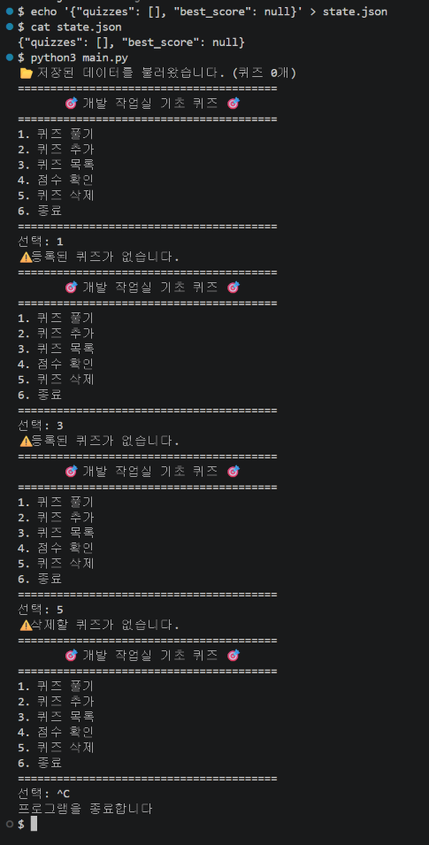

*`{"quizzes": [], "best_score": null}`로 퀴즈가 0개인 상태를 만들고 1(풀기)·3(목록)·5(삭제)를 눌렀을 때. 풀기는 문제 수를 묻기 전에 안내하고 메뉴로 돌아갑니다. 테스트 전에 `cp`로 백업하고 끝난 뒤 되돌렸습니다.*

### 종료 처리 (Ctrl+C, Ctrl+D)

| 누른 곳 | 처리 | 담당 | 확인 |
| --- | --- | --- | --- |
| 메뉴 `선택:`에서 | 프로그램을 종료합니다 → 저장 후 종료 | `run`의 try/except | 테스트 |
| 퀴즈 풀기·추가 도중 (문제 수, 정답, 문제 입력 등) | 프로그램을 종료합니다 → 저장 후 종료 | `main.py`의 try/except | 테스트 |

`Ctrl+C`는 `KeyboardInterrupt`, `Ctrl+D`는 `EOFError`입니다. 처음에는 메뉴 입력만 감싸서 퀴즈 도중에 누르면 오류 메시지(Traceback)와 함께 꺼졌는데, `main.py`에서 `game.run()` 전체를 감싸서 어디서 눌러도 안전하게 종료되도록 고쳤습니다. (13번 트러블슈팅 참고)

## 10. Git 작업 기록

## 11. 수행 체크리스트

## 12. 개발 과정

## 13. 트러블슈팅

## 14. 검증 방법

## 15. 배운 점과 알려진 한계

## 16. 제출 정보